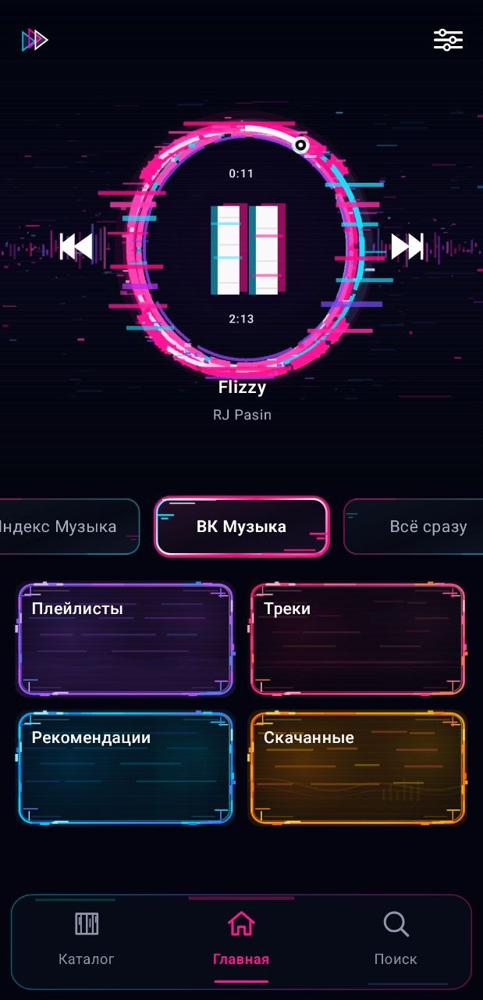

<p align="center">
  
</p>

<p align="center">
  <a href="https://github.com/Yellastro2/DWIJ-Music/releases"></a>
  <a href="https://github.com/Yellastro2/DWIJ-Music/releases"></a>
</p>

<p align="center">
  <a href="https://github.com/Yellastro2/DWIJ-Music/releases"></a>
  <a href="https://github.com/Yellastro2/DWIJ-Music/stargazers"></a>
  
  
  
</p>

<p align="center">
  <a href="#почему-движ">Почему Движ?</a> ·
  <a href="#возможности">Возможности</a> ·
  <a href="#скриншоты">Скриншоты</a> ·
  <a href="#установка">Установка</a> ·
  <a href="#разработка">Разработка</a> ·
  <a href="#обратная-связь">Обратная связь</a>
</p>

## О проекте

**Движ (DWIJ)** — музыкальный плеер с открытым исходным кодом для Android и Windows, объединяющий Яндекс Музыку, VK Музыку и локальные аудиофайлы. В отличие от обычного клиента одного музыкального сервиса, Движ позволяет работать с музыкой из разных источников как с единой фонотекой.

## Почему Движ?

<table>
  <tr>
    <td width="50%" valign="top">
      <strong><a href="#мультисурсы-одна-песня--несколько-источников">Мультисурсы</a></strong>
      <p>Одна песня — несколько источников. Движ находит возможные совпадения между Яндекс Музыкой, VK и локальными файлами, объединяет подтверждённые дубли и позволяет выбрать предпочтительную версию песни.</p>
    </td>
    <td width="50%" valign="top">
      <strong><a href="#единая-фонотека">Единая фонотека</a></strong>
      <p>Треки и плейлисты всех подключённых источников в одном месте. Слушайте музыку из разных сервисов в общей очереди.</p>
    </td>
  </tr>
  <tr>
    <td width="50%" valign="top">
      <strong><a href="#смешанные-рекомендации">Смешанные рекомендации</a></strong>
      <p>Персональные рекомендации Яндекс Музыки и VK чередуются в одной подборке.</p>
    </td>
    <td width="50%" valign="top">
      <strong><a href="#радиальное-меню">Музыка одним жестом</a></strong>
      <p>Настраиваемое радиальное меню: быстрый запуск любимых плейлистов, волн и подборок.</p>
    </td>
  </tr>
</table>

> [!NOTE]
> Проект активно развивается. Описанные возможности относятся к исходному коду основной ветки, а опубликованные сборки могут от него отставать. Windows-версия развивается как desktop-порт и имеет [отдельные ограничения](desktopApp/README_WINDOWS_PORT.md#ограничения-текущей-версии).

## Скриншоты

<p align="center">
  
  
  
  
</p>

<p align="center"><sub>Главный экран · Плеер · Фонотека · Источники песни</sub></p>

## Возможности

### Мультисурсы: одна песня — несколько источников

Одна и та же песня может быть доступна в Яндекс Музыке, VK Музыке и в виде локального файла. Движ позволяет связать эти записи в одну песню, не теряя исходные данные и принадлежность к музыкальным сервисам.

- Поиск возможных совпадений по метаданным уже известных приложению треков.
- Ручное подтверждение или отклонение совпадений; опциональное автоматическое объединение.
- Выбор предпочтительного источника воспроизведения для каждой песни.
- Выбор другой известной доступной версии при недоступности предпочтительной на этапе подготовки воспроизведения.
- Устранение подтверждённых дублей в общей фонотеке.

Например, если песня стала недоступна в Яндекс Музыке, но у вас есть связанная с ней локальная копия, Движ может воспроизвести её из файла.

### Единая фонотека

Режим **«Всё сразу»** объединяет личные коллекции и плейлисты подключённых источников. Можно просматривать общую библиотеку, запускать очередь из треков разных сервисов или переключаться между отдельными источниками.

Подтверждённые совпадения отображаются в общей коллекции треков как одна песня. Исходные плейлисты и коллекции при этом остаются в своих сервисах.

### Смешанные рекомендации

- «Моя волна», тематические волны и плейлист дня Яндекс Музыки.
- Рекомендации и персональные подборки VK Музыки.
- Общая подборка, чередующая рекомендации Яндекса и VK в одной очереди воспроизведения.

### Офлайн-воспроизведение

- Постоянное сохранение отдельных треков и целых плейлистов из Яндекс Музыки и VK отдельно от обычного кеша. (Не позволяет получить mp3 файлы песен)
- Кеширование аудио во время прослушивания.
- Автоматический переход к доступной офлайн-музыке после повторяющихся сетевых отказов и возврат к онлайн-очереди после восстановления соединения.

### Радиальное меню

Настраиваемое меню быстрого запуска музыки: назначьте на центральную кнопку Play и до пяти секторов любимые плейлисты, коллекции, рекомендации или волны Яндекс Музыки. Запускайте нужную музыку одним жестом.

### Музыкальные источники

| Возможность | Яндекс Музыка | VK Музыка | Локальная музыка |
|---|:---:|:---:|:---:|
| Воспроизведение | ✓ | ✓ | ✓ |
| Поиск внутри источника | ✓ | ✓ | ✓ |
| Личные плейлисты | ✓ | ✓ | ✓ |
| Любимые / мои треки | ✓ | ✓ | — |
| Персональные рекомендации | ✓ | ✓ | — |
| Офлайн-прослушивание | ✓ | ✓ | ✓ |
| Сопоставление и объединение песен | ✓ | ✓ | ✓ |

**Яндекс Музыка:** авторизация через OAuth Device Flow, «Моя волна» с отправкой событий начала, пропуска и прослушивания трека, любимые треки, плейлисты, создание плейлистов, добавление и удаление треков.

**VK Музыка:** авторизация, поиск по каталогу и личной коллекции, «Мои треки», плейлисты, рекомендации, добавление и удаление музыки из личной коллекции и плейлистов.

**Локальная музыка:** собственный каталог в Room, локальные файлы и плейлисты, экспорт M3U/M3U8.

### Плеер и интерфейс

- Общий интерфейс на Compose для Android и Windows.
- Фоновое воспроизведение и системное управление через Media3 / MediaSession на Android.
- JavaFX-аудиобэкенд и управление через панель задач Windows.
- Потоковое воспроизведение Яндекс Музыки на обеих платформах с собственным кешем диапазонов.
- Потоковое воспроизведение VK через HLS-relay.
- Фирменная тёмная тема интерфейса.

## Установка

Готовые сборки доступны на странице [GitHub Releases](https://github.com/Yellastro2/DWIJ-Music/releases).

| Платформа | Установщик | Требования |
|---|---|---|
| Android | APK | Android 8.0 (API 26) и новее |
| Windows | EXE | Windows; desktop-порт в разработке |

После установки откройте настройки приложения, подключите нужные музыкальные аккаунты или предоставьте доступ к локальной медиатеке. Для локальной музыки аккаунт музыкального сервиса не требуется. При необходимости настройки OAuth см. раздел [«Локальная настройка»](#локальная-настройка).

Движ — независимый неофициальный клиент, не связанный с Яндексом или VK. Доступность каталогов, отдельных треков и функций зависит от аккаунта, условий и работы API соответствующих сервисов.
Проект не предоставляет подписки на музыкальные сервисы и не обходит их ограничения. Для воспроизведения музыки, требующей подписки, необходимо иметь соответствующую действующую подписку на используемом аккаунте.
## Разработка

Движ построен на Kotlin Multiplatform и Compose: Android и Windows используют общие UI, навигацию, доменную модель, репозитории и настройки, а платформенные модули отвечают за интеграцию с ОС и воспроизведение.

### Архитектура

| Модуль | Назначение |
|---|---|
| `:shared` | Kotlin Multiplatform: общий Compose UI, навигация, доменная логика, репозитории, Room-модели и ресурсы для Android/JVM |
| `:app` | Android-приложение: lifecycle, MediaStore, Media3, разрешения, foreground service и платформенное хранилище |
| `:desktopApp` | Windows/JVM-приложение: JavaFX playback, файловая медиатека, desktop lifecycle и упаковка в EXE/MSI |
| [`:yaMusicSdk`](https://github.com/Yellastro2/YaMusicSDK) | Самостоятельная Kotlin/JVM-библиотека для API Яндекс Музыки и Yandex ID; Git submodule |
| [`:vkMusicSdk`](https://github.com/Yellastro2/vkMusicSdk) | Самостоятельная Kotlin/JVM-библиотека для API VK Музыки; Git submodule |

В центре доменной модели находится `Song` — логическая песня, с которой работают интерфейс и очередь плеера. Каждая песня может содержать несколько `TrackInstance` с собственными идентификаторами, метаданными и источниками. Для воспроизведения выбирается конкретный `PlaybackTrack`.

### Требования

- Git с поддержкой submodules;
- JDK 21;
- Android Studio и Android SDK 36 для сборки Android-приложения;
- Windows для запуска desktop-модуля и сборки EXE/MSI.

### Клонирование

```powershell
git clone --recurse-submodules https://github.com/Yellastro2/DWIJ-Music.git
cd DWIJ-Music
```

Если репозиторий уже был клонирован без submodules:

```powershell
git submodule update --init --recursive
```

### Локальная настройка

Создайте в корне `local.properties`. Android Studio обычно сама добавляет туда `sdk.dir`; параметры OAuth задаются вручную:

```properties
YANDEX_OAUTH_CLIENT_ID=...
YANDEX_OAUTH_CLIENT_SECRET=...
```

`local.properties` относится только к конкретному компьютеру и исключён из Git. Не публикуйте секреты или токены в репозитории.

Для desktop-упаковки можно дополнительно указать JDK:

```properties
DESKTOP_JAVA_HOME=C:/Program Files/Java/jdk-21
```

Если `DESKTOP_JAVA_HOME` отсутствует, Compose Desktop использует JDK, на котором запущен Gradle.

OAuth-параметры установленному Windows-приложению также можно передать через переменные окружения `DWIJ_YANDEX_OAUTH_CLIENT_ID` и `DWIJ_YANDEX_OAUTH_CLIENT_SECRET`.

### Запуск и сборка

Android-приложение можно запустить конфигурацией `app` в Android Studio или собрать из PowerShell:

```powershell
.\gradlew.bat :app:assembleDebug
```

Запуск Windows-приложения:

```powershell
.\gradlew.bat :desktopApp:run
```

Сборка установщиков Windows:

```powershell
.\gradlew.bat :desktopApp:packageExe
.\gradlew.bat :desktopApp:packageMsi
```

### Тестирование

Основные локальные тесты:

```powershell
.\gradlew.bat :app:testDebugUnitTest
.\gradlew.bat :desktopApp:test
.\gradlew.bat :yaMusicSdk:test
```

Инструментальные Android-тесты требуют подключённого устройства или эмулятора.

### Документация

| Документ | Содержание |
|---|---|
| [Windows-порт](desktopApp/README_WINDOWS_PORT.md) | Устройство desktop-версии, настройка, ограничения |
| [Смешанные треклисты](docs/mixed-tracklists.md) | Общая фонотека, очереди, рекомендации и скачанные треки |
| [VK Музыка](docs/vk-music.md) | Интеграция VK, поиск, плейлисты, сопоставление песен |
| [Авторизация Яндекс Музыки](docs/yandex-authorization.md) | OAuth Device Flow |
| [Потоковое воспроизведение Яндекс Музыки](docs/yandex-streaming.md) | Кеш диапазонов, Android DataSource, desktop relay и сценарии проверки |
| [Офлайн-воспроизведение](docs/offline-playback.md) | Автоматический офлайн и восстановление очереди |
| [Радиальное меню](docs/radial-menu-settings.md) | Настройка быстрого запуска |
| [Плейлист дня](docs/daily-playlist.md) | Работа ежедневной подборки |
| [Roadmap](roadmap.md) | Планы и текущий статус разработки |

`YaMusicSDK` использует знания о контрактах и поведении API из [MarshalX/yandex-music-api](https://github.com/MarshalX/yandex-music-api), но не является построчным переносом Python-библиотеки на Kotlin. Исходную Python-библиотеку можно использовать как справочник при исследовании API; для сборки Движа её локальная копия не требуется.

### Похожие приложения

[BitChord](https://github.com/kushagrasinghx/BitChord) — музыкальный клиент на Kotlin/Compose с YouTube Music, заявленной Spotify-интеграцией и desktop-версией. [Заметка для изучения](docs/legend/similar-music-apps.md) описывает полезные для Движа направления и ограничения проверки интеграций.

## Обратная связь

Нашли ошибку или хотите предложить новую возможность? Создайте [Issue](https://github.com/Yellastro2/DWIJ-Music/issues/new). При описании проблемы укажите платформу, версию приложения, музыкальный источник и шаги для воспроизведения. Не прикладывайте пароли и токены авторизации.

Если вам близка идея единой музыкальной фонотеки, поставьте ⭐ [репозиторию](https://github.com/Yellastro2/DWIJ-Music) — это помогает другим пользователям найти проект.

## Лицензия

Приложение «Движ» распространяется под лицензией GNU GPL v3.0.

Модуль `yaMusicSdk` основан на проекте [MarshalX/yandex-music-api](https://github.com/MarshalX/yandex-music-api), который распространяется под лицензией GNU LGPL v3.0. `yaMusicSdk` также распространяется под GNU LGPL v3.0. Авторские права на оригинальный проект принадлежат его авторам и участникам.
